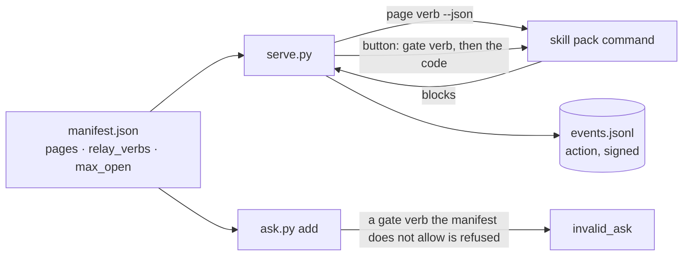

# A skill pack's pages, buttons and verbs

The console is one place for the owner: the asks, and the pages the skill pack adds (its space, its next batch, its evidence). One frame (the top bar with a number on each tab, light and dark, the 375 px layout, the safety checks and the signed log) is the console's; **what the pages say, and what a button does, is the skill pack's.** The skill pack declares it in one file, the **manifest**; it writes no HTML and holds no secret.



## Register: the manifest

One JSON file in the skill pack. The operator starts the console with `serve.py --manifest FILE` (or `$CONSOLE_MANIFEST`); the agent's `ask.py --manifest FILE add` reads the same file (or `$CONSOLE_MANIFEST`). It replaces `--relay-cmd` and `--relay-verbs`, which it excludes.

```json
{
  "version": 1,
  "cmd": ["uv", "run", "my_skill_pack.py"],
  "relay_verbs": [["facts", "confirm"], ["queue", "approve"]],
  "max_open": 20,
  "counts": ["console", "counts"],
  "pages": [
    {"name": "space", "title": {"en": "Space", "zh": "空间"}, "order": 20,
     "verb": ["console", "page", "space"], "blocking": true}
  ]
}
```

| Key | Meaning |
| --- | --- |
| `version` | `1`. A file for a newer console is refused, not guessed at |
| `cmd` | The skill pack command (argv). It runs every page verb and every gate; an ask or a page cannot change it |
| `relay_verbs` | The verb prefixes (word lists) a gate or a button may run. Default: none |
| `max_open` | How many asks may be open at once (1 to 100; default 10). `ask.py add --max-open N` can still only lower it |
| `counts` | Optional verb that prints `{"counts": {"<page>": N}}`: the number on each tab. The console keeps it for 5 seconds; if it fails the tabs have no numbers and the pages work |
| `pages` | At most 12. `name` (a-z, 0-9, `_`; the page is `page-<name>`), `title` (text, or `{en, zh}`), `order` (the built-in Waiting is 10 and History 1000), `verb` (the page verb), `blocking` (true: its number is added to the Waiting tab, the owner's "what blocks the next step" count) |

An unknown key is an error, and so is a name the console uses itself. A manifest that cannot be read stops `serve.py` (exit 2) and refuses `ask.py add` (`bad_request`); it is never read as "no manifest".

## A page: the verb prints blocks

`<cmd> <verb…> --lang=en|zh --json` prints one JSON object and exits 0. It must only read. The console draws it inside the frame, escaped; a block that is not valid is left out and the page says how many (one bad block never hides the rest); a command that fails or hangs (30 seconds) gives a page that says so.

```json
{"count": 2, "blocks": [
  {"type": "heading", "text": "Next batch"},
  {"type": "card", "title": "Deliver 3 clips", "blocks": [
    {"type": "text", "text": "Three clips for row N7."},
    {"type": "facts", "items": [{"label": "Cost", "value": "¥120"}]},
    {"type": "details", "summary": "The clips", "blocks": [
      {"type": "table", "columns": ["Clip", "Length"], "rows": [["N7-1", "21 s"]]}]},
    {"type": "button", "label": "Confirm delivery", "verb": ["queue", "approve"],
     "expect": {"verb": "queue approve", "items": {"batch": "n7"}},
     "effect": "Sends 3 clips to the client."}]}]}
```

Block types: `heading`, `text`, `facts`, `table`, `link` (http and https only), `details` (folded), `card` (a box that opens) and `button`. Limits (`frame.BLOCK_LIMITS`): 300 blocks, 3 levels of `details` and `card`, text 2000 characters, a table 6 columns by 30 rows. `count` is the number for this page's tab when the `counts` verb has none.

## A button: the person's click is the proof

`button` is a gate the owner can click: `verb`, `expect` and `market` mean what they mean in an ask's `gate` ([the gate](README.md#gate-connect-a-skill-pack)); a button has no value, so no `value_arg`. `effect` says in plain words what it does; the folded box above the button lists what exactly will be written.

1. The form carries only the page name and the button's hash (of its label, effect and gate). It carries no verb, no payload and no gate word, and the console ignores any it is sent.
2. At the click the console draws the page again. If the button is no longer there, unchanged, the click is refused (`changed`: reload) and nothing runs.
3. It then runs the gate exactly as for an answer: the verb, a challenge with a one-time code, the check that the skill pack's `subject` matches `expect`, the code sent back with the person's name. The code never reaches the page or the agent; the agent holds no secret.
4. The result is the signed, append-only `action` event in `events.jsonl`: who, which page and button, the hash, the verb and the skill pack's words. `ask.py verify` checks it like an answer. An action is not an answer: no ask changes.

Nothing is drawn for a read-only viewer. Two clicks on one button never run twice at once.

## Relay verbs: allowed in one place

The manifest's `relay_verbs` decide which gates and buttons can run, and they are checked early, where the mistake is made:

- **An ask** whose `gate.verb` starts with none of them is refused by `ask.py add` (`invalid_ask`, field `gate.verb`, code `not_allowed`, naming the verb and the allowed ones), together with every other problem of the batch, nothing posted. Without a manifest `add` cannot know, so set `CONSOLE_MANIFEST` in the agent's environment.
- **A button** whose verb is not allowed is not drawn as a form: the page says in a sentence that it cannot run here. A click forged for it is refused (`verb_not_allowed`) before the skill pack is called.

A prefix matches word for word: `["queue", "approve"]` allows `queue approve` and `queue approve n7`, not `queue approvals`.

## What the skill pack still owns

The page verbs and their data, the gate verbs and their codes (a skill pack's own human gate stays where its rules live), and the words on its pages. Not here: forms with typed fields on a page, file upload, and video or image files (the page shows text and tables; a link may point at a file served elsewhere).

## Tests

`test_manifest.py` (the file and the verbs at registration), `test_frame.py` (the blocks and the bar), `test_frame_serve.py` (a real console with a stand-in skill pack, `tests/fake_pages.py`). To try it in a browser at 375 px, start the console with a manifest and a stand-in command, and check the bar scrolls inside itself and a button click shows the notice and leaves the page where it was.
