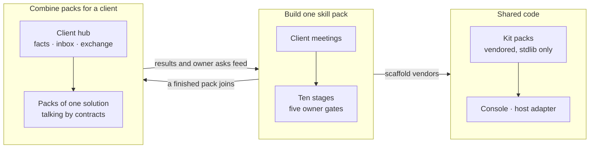
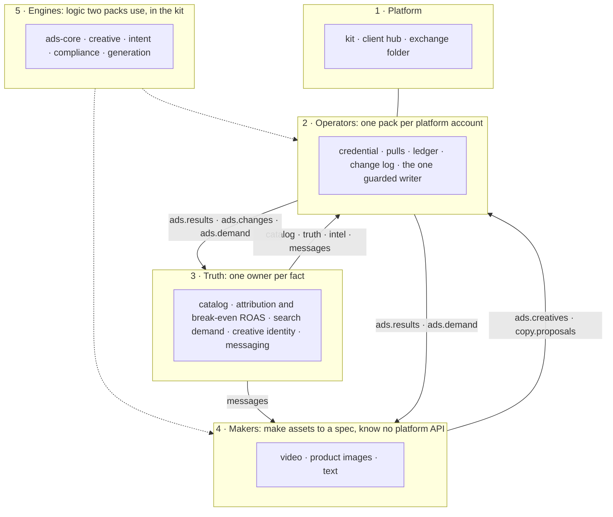
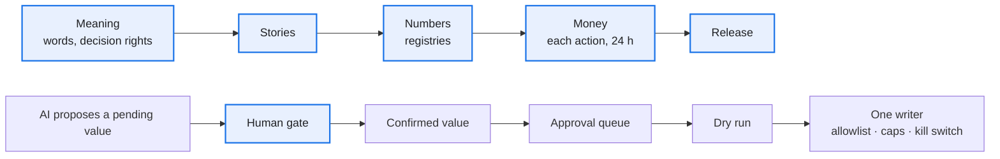
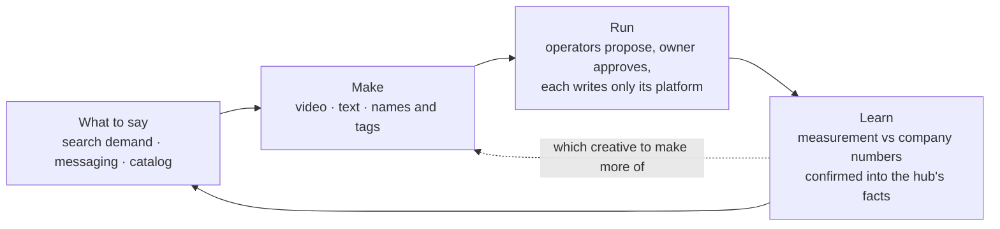
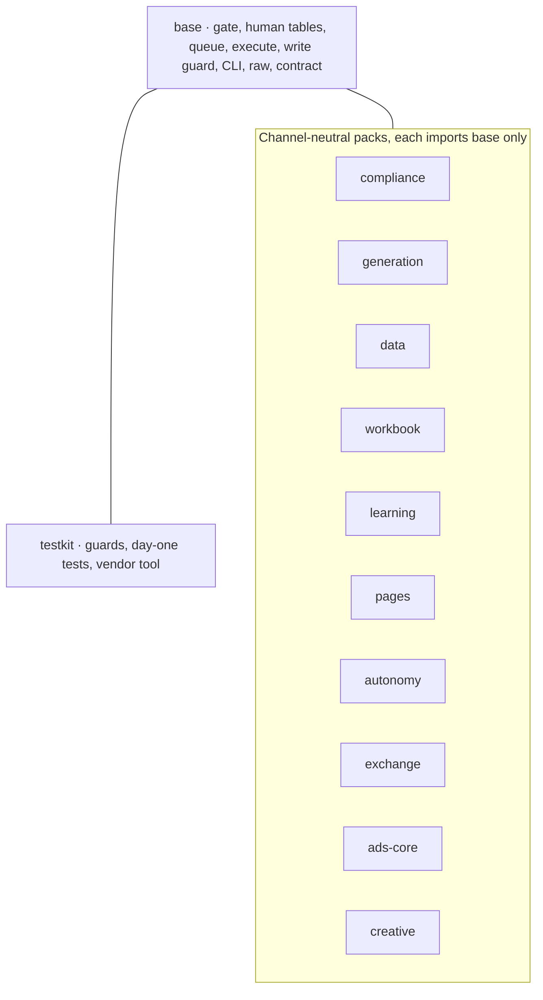

# The growth framework on one page

How the parts fit: what a skill pack is, how one is built, how several work together for a client, and where the shared code sits. Detail is one link away; this page only joins the views. State as of 2026-10-26, from [ROADMAP.md](../ROADMAP.md) and [portfolio.md](portfolio.md); for a live count run `python3 tools/fleet.py status PATH…` and `python3 tools/consumers.py PATH…`.

## 1. Three views, one system

| View | Answers | Read |
| --- | --- | --- |
| Build | How a pack goes from a meeting to production | [README](../README.md), [BUILD.md](../BUILD.md), [stages.md](stages.md) |
| Combine | Which packs a client needs and how they hand work over | [portfolio.md](portfolio.md), [solutions.md](solutions.md) |
| Share | What code is common and how a pack gets it | [kit/README.md](../kit/README.md), [kit-and-tools.md](kit-and-tools.md) |

## 2. The five layers

Five rules hold it together ([portfolio.md](portfolio.md#ownership-rules)): one operator per platform account; one owner per fact; one writer per external field; a pack never opens another pack's database; a client's own data lives in its hub, never in a pack.

## 3. Where the owner decides

A person confirms exactly what was shown; only a human raises a value's trust; nothing is written outside the queue. At most 10 open asks per owner across a client's packs ([rules.md](rules.md), [autonomy.md](autonomy.md)).

## 4. Five solutions

| Solution | For | Operators |
| --- | --- | --- |
| A. Brand, paid growth on several channels | a direct-to-consumer brand with a site, ads and creators | `video-ads`, `google-ads`; creators' packs |
| B. Short-video commerce, regulated category | feed video on Chinese platforms, claims a regulator limits | `video-ads` with `compliance` |
| C. Marketplace seller | sales on Amazon | `amazon-ppc` |
| D. B2B, organic and sales-led | buyers won by search, AI answers and outreach | `ecommerce-seo`, `geo-china`, `outbound`, `sdr` |
| E. Our own acquisition | the agency's own pipeline | the SEO, outreach and sales packs |

A client may need two; each pack still runs only its own platform. Start order: the operator closest to the money, then `measurement`, then makers, then the other truth packs ([solutions.md](solutions.md#starting-a-client)).

## 5. The loop for solution A

## 6. The kit's packs

A skill pack names the kit packs it takes in `skill-pack.toml`; a pack imports only `base` and itself ([kit/packs.tsv](../kit/packs.tsv), tested by `kit/tests/test_packs.py`).

A new module goes into the pack named for its concern, never `base`. It moves to `base` when two skill packs import it from code merged to their main branches ([CLAUDE.md](../CLAUDE.md)).

## 7. Where it stands (2026-10-26)

| Part | State |
| --- | --- |
| Kit | 0.40.0; packs and selective vendoring built |
| Packs in use on the kit | the creator-video pack and the short-video ad pack, on different kit versions; bringing them to one is the open turn (ROADMAP N2) |
| Client hub, contracts | built; no real client has moved onto a hub yet (X10); three contracts exist, the rest are drafts a first producer and consumer settle |
| Truth packs | scaffolds or local only |
| Waiting on the owner | ROADMAP, "Waiting on owner" |

This table is hand-written and goes stale: the commands at the top of the page are the source.
