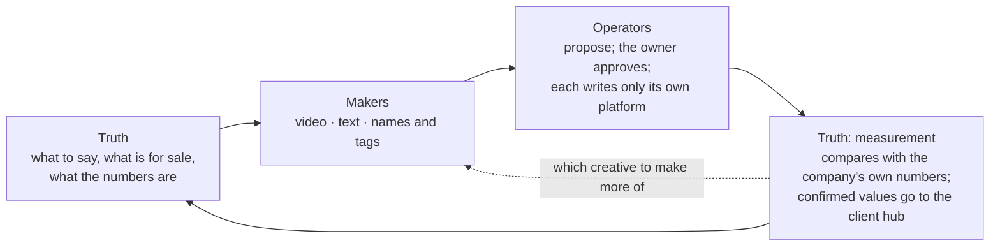
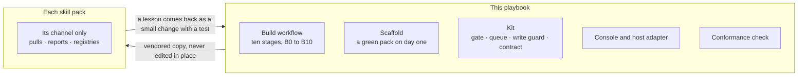
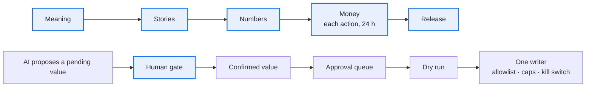
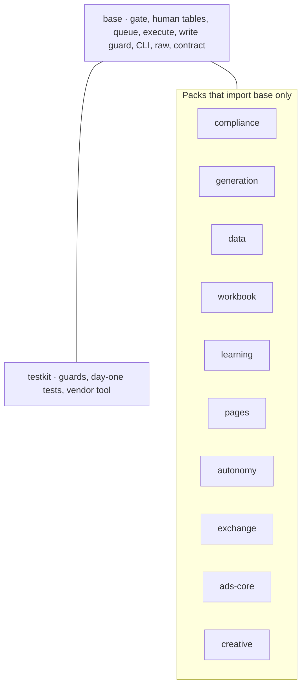

# The growth framework on one page

Two questions, answered apart. **Part 1:** in growth operations, who owns what. **Part 2:** how this playbook makes every skill pack alike, what it unifies and what it saves each pack. State as of 2026-10-26, from [ROADMAP.md](../ROADMAP.md) and [portfolio.md](portfolio.md); for live counts run `python3 tools/fleet.py status PATH…` and `python3 tools/consumers.py PATH…`.

---

# Part 1 · Growth operations: who owns what

Each skill pack is one specialist on a client's team. A client's growth work is cut into three roles, plus the owner.

| Role | Does | Never does | Examples |
| --- | --- | --- | --- |
| **Operator** | Holds one platform account: pulls its data, reports, proposes actions, and writes to the account once approved | Touches another platform; invents its own number for a shared fact | `video-ads` (Meta, 千川, 腾讯), `google-ads`, `amazon-ppc`, `ecommerce-seo` |
| **Truth** | Owns one kind of number the others need and publishes it | Runs ads; writes to any account | `product-feed` (price, stock), `measurement` (attribution, break-even ROAS), `search-intel` (demand, competitors) |
| **Maker** | Makes assets to a spec and hands them over with a manifest | Knows a platform's API; uploads | `adcut` (video), `ad-copy` (text), `product-keyframe-video` (images) |
| **Owner** | Signs five things: meaning, stories, numbers, money, release | | |

Five rules keep the roles apart ([portfolio.md](portfolio.md#ownership-rules)):

1. **One operator per platform account.** Nobody else holds its credential or writes to it.
2. **One owner per fact.** A price, a break-even ROAS or a coefficient is published by its owner; the rest read it.
3. **One writer per external field.** Website product content belongs to `seo`; merchant-feed overrides belong to `feed`.
4. **A pack never opens another pack's database.** It reads versioned `--json` documents, written once into the client hub's exchange folder.
5. **A client's own data lives in its hub,** never in a pack.

Which packs a client needs depends on the business ([solutions.md](solutions.md)):

| Solution | For | Operators |
| --- | --- | --- |
| A. Brand, paid growth on several channels | a direct-to-consumer brand with a site, ads and creators | `video-ads`, `google-ads`; creators' packs |
| B. Short-video commerce, regulated category | feed video on Chinese platforms, claims a regulator limits | `video-ads` with `compliance` |
| C. Marketplace seller | sales on Amazon | `amazon-ppc` |
| D. B2B, organic and sales-led | buyers won by search, AI answers and outreach | `ecommerce-seo`, `geo-china`, `outbound`, `sdr` |
| E. Our own acquisition | the agency's own pipeline | the SEO, outreach and sales packs |

A client may need two. Start order: the operator closest to the money, then `measurement`, then makers, then the other truth packs.

---

# Part 2 · The playbook: what it unifies, what it saves

The playbook does no growth work and holds no channel logic. It is the factory that builds skill packs and the safety parts they share. A skill pack adds only its channel: its pulls, reports, registries and the hooks the kit calls.

| Unified | What it means in practice |
| --- | --- |
| The gate | A person confirms exactly what was shown, by retype or a one-time code. There is no bypass flag. |
| Human data | A client's facts and decisions stay pending until a person confirms them, keep their history, and are never dropped or shrunk. |
| The money path | Nothing goes out unapproved: queue, approval that expires, dry run, opt-in, exact-shape allowlist, kill switch. |
| Raw data | Raw files are written once, atomically; a second scheduled run skips; throttling is a recorded gap. |
| Talking to an agent | Every command prints one `--json` document, failures included; every message has a code from a closed registry. |
| The build | Ten stages, five owner gates, the same for every pack. |
| The owner's door | One console, one inbox, at most 10 open asks per owner across a client's packs. |
| Hand-offs | Twelve contracts and one exchange folder. |

| What a skill pack saves | How |
| --- | --- |
| Writing the safety parts | Scaffold generates a pack with the kit and the thirteen day-one tests, green before its first feature. |
| Designing the process | [BUILD.md](../BUILD.md) and the build skill are the process. |
| Building a console | The console is vendored with the pack. |
| Keeping up | `fleet.py` shows where each copy stands; `vendor.py` brings it up to date; a local edit to a vendored byte fails the drift test, so the fix goes upstream first. |
| Carrying what it does not use | A pack takes only the kit packs it names in `skill-pack.toml`. |

Where the owner decides, and how a value earns trust:

Only a human raises a value's trust; anyone may lower it.

The kit is split into packs, and a skill pack names the ones it takes. A pack imports only `base` and itself; `kit/tests/test_packs.py` enforces it ([kit/packs.tsv](../kit/packs.tsv)).

A new module goes into the pack named for its concern, never `base`. It moves to `base` when two skill packs import it from code merged to their main branches ([CLAUDE.md](../CLAUDE.md)).

## Where it stands (2026-10-26)

| Part | State |
| --- | --- |
| Kit | 0.40.0; packs and selective vendoring built |
| Unified across packs | Only for the two packs in use, and they sit on different kit versions; bringing them to one is the open turn (ROADMAP N2) |
| Truth packs | Scaffolds or local only; the "learn" step of the loop has barely run |
| Client hub, contracts | Built; no real client has moved onto a hub yet (X10). Three contracts exist, the rest are drafts a first producer and consumer settle |
| Waiting on the owner | ROADMAP, "Waiting on owner" |

This table is hand-written and goes stale: the commands at the top of the page are the source.
