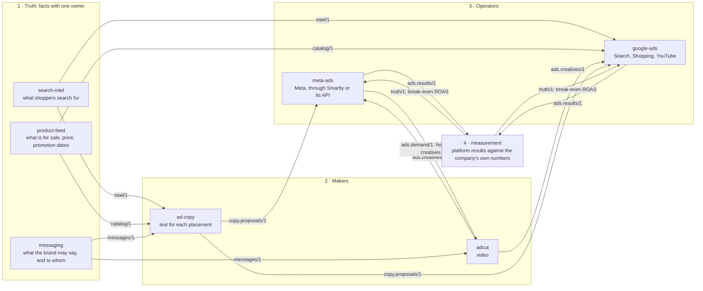
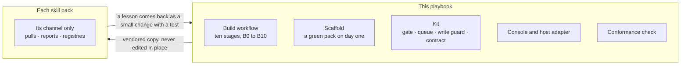
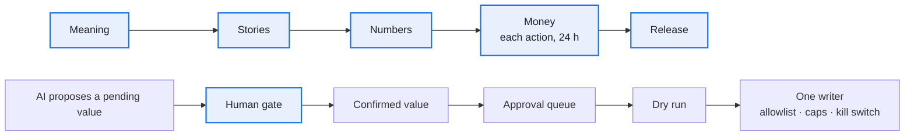
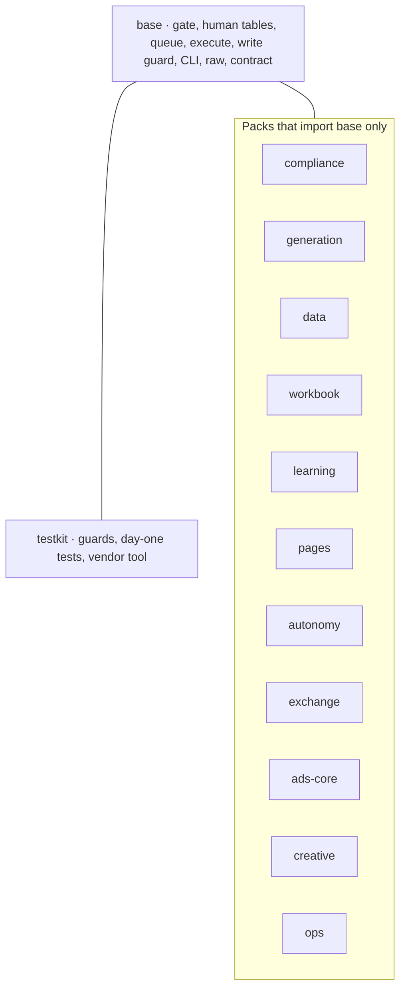

# The growth framework on one page

Two questions, answered apart. **Part 1:** in growth operations, who owns what. **Part 2:** how this playbook makes every skill pack alike, what it unifies and what it saves each pack. State as of 2026-10-26, from [ROADMAP.md](../ROADMAP.md) and [portfolio.md](portfolio.md); for live counts run `python3 tools/fleet.py status PATH…` and `python3 tools/consumers.py PATH…`.

---

# Part 1 · Growth operations: who owns what

Each skill pack is one specialist on a client's team. A client's growth work is cut into three roles, plus the owner.

| Role | Does | Never does | Examples |
| --- | --- | --- | --- |
| **Operator** | Holds one platform account: pulls its data, reports, proposes actions, and writes to the account once approved | Touches another platform; invents its own number for a shared fact | `meta-ads` (Meta), `video-ads` (千川, 腾讯), `google-ads`, `amazon-ppc`, `ecommerce-seo` |
| **Truth** | Owns one kind of number the others need and publishes it | Runs ads; writes to any account | `product-feed` (price, stock), `measurement` (attribution, break-even ROAS), `search-intel` (demand, competitors) |
| **Maker** | Makes assets to a spec and hands them over with a manifest | Knows a platform's API; uploads | `adcut` (video), `ad-copy` (text), `product-keyframe-video` (images) |
| **Owner** | Signs five things: meaning, stories, numbers, money, release | | |

### How the work moves

Follow one example: a brand launches a spring promotion on Meta and Google. Each arrow is **a document one pack hands to another**, and its label is the document's name ([contracts](../contracts/README.md)). Nothing else passes between packs.

1. **Truth packs** say what is true: what shoppers search for, what is for sale and when the promotion runs, what the brand may say and to whom.
2. **Makers** turn that into ads: video and text.
3. **Operators** run them. Each proposes changes, the owner approves, and each writes only to its own platform.
4. **`measurement`** checks the platforms' results against the company's own numbers and hands back the break-even ROAS to aim for. Operators also tell the makers how many creatives they need.

Five rules keep the roles apart ([portfolio.md](portfolio.md#ownership-rules)):

1. **One operator per platform account.** Nobody else holds its credential or writes to it.
2. **One owner per fact.** A price, a break-even ROAS or a coefficient is published by its owner; the rest read it.
3. **One writer per external field.** Website product content belongs to `seo`; merchant-feed overrides belong to `feed`.
4. **A pack never opens another pack's database.** It reads versioned `--json` documents, written once into the client hub's exchange folder.
5. **A client's own data lives in its hub,** never in a pack.

Which packs a client needs depends on the business ([solutions.md](solutions.md)):

| Solution | For | Operators |
| --- | --- | --- |
| A. Brand, paid growth on several channels | a direct-to-consumer brand with a site, ads and creators | `meta-ads`, `google-ads`; creators' packs |
| B. Short-video commerce, regulated category | feed video on Chinese platforms, claims a regulator limits | `video-ads` with `compliance` |
| C. Marketplace seller | sales on Amazon | `amazon-ppc` |
| D. B2B, organic and sales-led | buyers won by search, AI answers and outreach | `ecommerce-seo`, `geo-china`, `outbound`, `sdr` |
| E. Our own acquisition | the agency's own pipeline | the SEO, outreach and sales packs |

A client may need two. Start order: the operator closest to the money, then `measurement`, then makers, then the other truth packs.

---

# Part 2 · The playbook: what it unifies, what it saves

The playbook does no growth work and holds no channel logic. It is the factory that builds skill packs and the safety parts they share. A skill pack adds only its channel: its pulls, reports, registries and the hooks the kit calls.

| Unified | What it means in practice |
| --- | --- |
| The gate | A person confirms exactly what was shown, by retype or a one-time code. There is no bypass flag. |
| Human data | A client's facts and decisions stay pending until a person confirms them, keep their history, and are never dropped or shrunk. |
| The money path | Nothing goes out unapproved: queue, approval that expires, dry run, opt-in, exact-shape allowlist, kill switch. |
| Raw data | Raw files are written once, atomically; a second scheduled run skips; throttling is a recorded gap. |
| Talking to an agent | Every command prints one `--json` document, failures included; every message has a code from a closed registry. |
| The build | Ten stages, five owner gates, the same for every pack. |
| The owner's door | One console, one inbox, at most 10 open asks per owner across a client's packs. |
| Hand-offs | Twelve contracts and one exchange folder. |

| What a skill pack saves | How |
| --- | --- |
| Writing the safety parts | Scaffold generates a pack with the kit and the thirteen day-one tests, green before its first feature. |
| Designing the process | [BUILD.md](../BUILD.md) and the build skill are the process. |
| Building a console | The console is vendored with the pack. |
| Keeping up | `fleet.py` shows where each copy stands; `vendor.py` brings it up to date; a local edit to a vendored byte fails the drift test, so the fix goes upstream first. |
| Carrying what it does not use | A pack takes only the kit packs it names in `skill-pack.toml`. |

Where the owner decides, and how a value earns trust:

Only a human raises a value's trust; anyone may lower it.

### How much a write may run without asking: autonomy levels

A skill pack that writes into someone else's system runs each write at a level, from **L0 to L5**. The level says who decides that write and what proof it carries ([autonomy.md](autonomy.md); the shared code is the kit's `autonomy` pack). Today's default is L1: a person approves each change.

| Level | Who decides each write | Example | State |
| --- | --- | --- | --- |
| **L0** hand-carried | A person, in the platform itself; the skill pack writes nothing | The write switches are off, or the kill switch dropped every level to here | The floor |
| **L1** per-change consent | A person approves each change, by retyping it or a one-time code | The Amazon Ads skill pack's queue | In use |
| **L2** scoped approval | A person approves a work item with a scope frozen at proposal; the skill pack writes inside it, within caps | SEO: internal links, a cover image, meta title | In use, one skill pack |
| **L3** owner-switched mode | The owner switches a mode on once, for at most 28 days; the skill pack writes only kinds the owner chose, each with a code-free undo | SEO: a new article, a new 301 | In use, one skill pack |
| **L4** rule-started work | A tested rule picks the work itself; no per-item approval | None yet | Not built |
| **L5** full autonomy | The agent picks the goals and the writes | None, by design: public exposure and money spent do not come back | Not built |

Four rules hold at every level: the skill pack classes each write, never the agent; a level is a ceiling per kind of write, not a mode of the whole skill pack; raising takes a person and lowering takes anyone (the owner's switch, an expiry, a cap or the kill switch); above L1 every write is capped, counted from the archive, and has an undo.

The kit is split into packs, and a skill pack names the ones it takes. A pack imports only `base` and itself; `kit/tests/test_packs.py` enforces it ([kit/packs.tsv](../kit/packs.tsv)).

A new module goes into the pack named for its concern, never `base`. It moves to `base` when two skill packs import it from code merged to their main branches ([CLAUDE.md](../CLAUDE.md)).

How far each skill pack is on the kit is a level, L0 to L3, with the command that proves it ([INVARIANTS.md](../conformance/INVARIANTS.md), "Adoption levels"); [tools/adoption.tsv](../tools/adoption.tsv) holds every pack's level and target.

## Where it stands

Run the two commands at the top of this page, and read [ROADMAP.md](../ROADMAP.md): a table here went stale within days.
