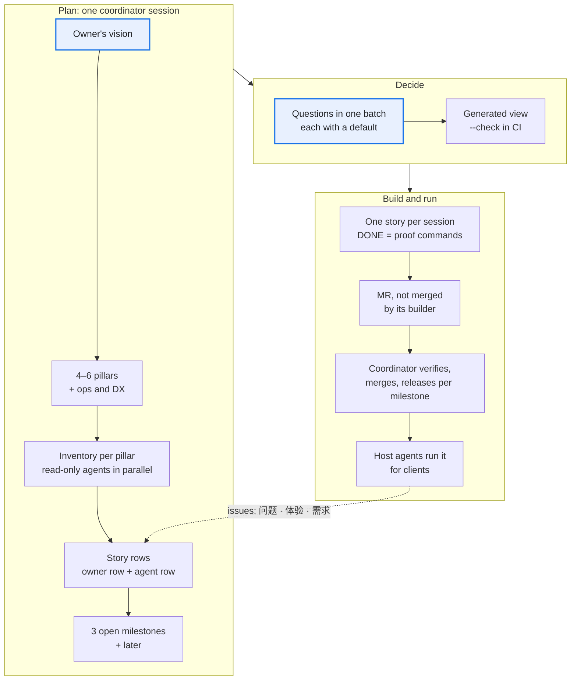

# Roadmap: planning a harness (worked example: SEO 路线图)

How to turn an owner's vision into the next months of work for a harness that already runs: which pillars, which stories, in which order, done when, and who builds them. Use it after the first milestone has shipped and again at each milestone's end.

This is the product roadmap: what the harness will do, held in the story registry ([Stories that prove themselves](rules.md#stories-that-prove-themselves)). It is not [`ROADMAP.md`](../templates/ROADMAP.md), the session log of turns (Now, Waiting, Next). That file's rows name story ids and never restate them.

*Seen once:* the SEO harness, on the owner's request of 2026-10-14. One pass turned a vision into 43 story rows in six pillars and three open milestones. The owner answered the questions that blocked work the same day; seven more still run on their recommended answers.



## The method

1. **Start from the owner's vision, cut into four to six pillars plus one for operations.** A pillar is an outcome the owner can name, such as "a site with the pages a buyer expects". It is not a module. The extra pillar (platforms, upgrades, backups, tests, developer experience) collects what keeps the rest cheap to build. Without it that work lands nowhere and is never scheduled.
2. **Inventory each pillar in parallel with read-only agents.** Each agent gets the vision, its pillar and the repository, and returns one fixed table: capability, state (`exists`, `partial`, `missing`), evidence (file, verb, test), gap against the vision, the smallest task on existing tables and paths, its size (XS to L), and any owner question. It also returns a **do not build now** list, each entry with the condition that would bring it back. A read-only agent cannot start building while it plans, and evidence makes a claimed gap checkable. *Seen once:* the inventory found four stories built but still marked open, and a test file named in a docstring that did not exist.
3. **The roadmap lives in the story registry, not in a plan document.** Each task is one story with two rows of one id:
   - **the owner row**, in business language: milestone, human step (`none`, `confirm`, `provide`), I want, so that, given, then (numbered items);
   - **the agent row**: status, blocking issue, **proof commands** (the mechanical DONE: each command with what it must print), data dependencies, and notes. The notes give the pillar, why, the smallest change, the files touched, the size, and any `owner pending: question? (recommended: answer)` or `BLOCKED on owner: …`.

   A plan document drifts from the registry within days. A row cannot, because tests read it.
4. **A generated view, never hand-edited.** A script builds one read-only page from the two files: milestones in order, each story with its want, who acts, its status, its size and its open owner question. Collapse a milestone that is all done. Its `--check` mode exits 1 when the page is stale, and the docs test runs it. The owner reads the roadmap without opening a TSV.
5. **Tests hold the registry.** Every open story names a milestone. Every owner row has its agent row. A rejected story has no owner row, and a story merged into another names a live one. Ids are unique and never reused. An adopted proposal is cleared from the `proposed` cell.
6. **Few milestones, ordered by what unblocks real use.** Keep three open milestones plus `later`. The first is small and stabilises what runs (registry truth, upgrades, backups, faster tests). The next ones follow the loop the clients use, so each milestone makes the one after it measurable. Collapse done milestones. *Seen once:* the first pass had six open milestones. The owner folded them into three the same day ("把里程碑缩成三段"): six were more segments than anyone tracked.
7. **Batch the owner's questions, each with a recommended default.** One ask holds every open question. Each question sits in its story's notes with the answer the agent would pick. The implementer uses that answer unless the owner has given another, so an unanswered question never holds the plan ([rule 13](rules.md#human-in-the-loop-rules)). Only a question whose wrong answer cannot be undone (a new write kind, a new credential, personal data) is `BLOCKED`, and only that story waits.
8. **Size each row for one session.** XS and S rows are a few files. An M row touches a new table or verb. An L row is split, or goes to a stronger model with the coordinator watching. A row that needs a second session was planned too big.

## Executing it

1. **One story per session, on a cheaper model.** A well-specified row (proof commands, files, smallest change) does not need the strongest model. *Seen once:* the SEO harness's roadmap rows were written for Sonnet sessions, with the coordinator on the stronger model.
2. **DONE is three machine checks:** every proof command behaves as its row says; the full suite ends `RESULT: N passed` with 0 failed; the host check passes. Prose is not DONE.
3. **The builder opens a merge request and does not merge it.** The coordinator re-runs the proof commands on the branch, reads the diff against the row's smallest change, and merges. A builder's report is not trusted on its own ([Building with many agents](operating.md#building-with-many-agents), rule 5).
4. **Release per milestone, not per fix.** A tag closes a milestone, or a fix a client is waiting on. *Paid for:* the source project cut 21 tags in five days ([stages](stages.md#stage-0-and-the-ten-stages-one-line-each), stage 9).

The prompt every builder session starts from (fill the braces):

```text
You implement story {id} of {harness}, and nothing else.

Read first: CLAUDE.md; the story's owner row and agent row in the story registry;
the files its notes name. Run `{cli} --help` for every verb you touch.

Before you start:
- If the agent row says BLOCKED, stop and report why. Build nothing.
- For each "owner pending: question? (recommended: answer)", look for the owner's
  answer: the owner file, the inbox, comments on earlier merge requests. Use it;
  otherwise use the recommended answer, and say so in the merge request.
- Fetch origin. Work in your own worktree on a branch from origin/main.

While you work:
- Make the smallest change on the tables and paths the notes name. No new subsystem.
- Every new threshold, message code or registry row comes with its reader and test.
- Do not allocate a new story id. Work outside this story goes in the merge
  request description, for the coordinator.
- A question of meaning you cannot answer from the row: stop and return it with
  your recommendation. Do not guess.

Done when all three hold, and you paste their output in the merge request:
1. every proof command in the agent row behaves as stated;
2. {test command} ends RESULT with 0 failed;
3. {host check} passes.

Then set the agent row's status to done, regenerate the roadmap view, commit with
the story id in the title, and open the merge request. Do not merge it.
```

## Feedback from production testers

People who run the harness for real clients file issues. Three templates, in the owner's language, give three kinds of report:

| Template | For | It asks for |
| --- | --- | --- |
| 问题 (problem) | wrong output, an error, a result that contradicts `--help` | version line, the commands run, expected, actual, the `--json` output, the story it touches |
| 体验 (experience) | no error, but too many steps, an unclear message, repeated confirms | what they wanted, the steps, where they got stuck, a suggestion |
| 需求 (need) | a new story | milestone, human step, I want, so that, given, then, evidence; the agent fills in the smallest change and any owner question |

Every template begins with what must never be pasted: secrets, codes, env files, contact data of the client's customers. Labels carry the milestone, the type and the client (`client:<domain>`). Triage sends each issue to one of three places: a fix under an existing story, a new story row in the registry, or the client's own data (a fact, a decision) when nothing in the harness is wrong ([triage checklist](../templates/triage-checklist.md)). A rule seen on one client stays proposed until a client with another business model confirms it ([operating](operating.md#when-agents-file-the-issues), rule 7).

## Who works where

| Session | Runs in | Does | Never |
| --- | --- | --- | --- |
| Coordinator | the dev checkout, on main | allocates story ids, writes roadmap rows, asks the owner, verifies and merges, tags releases | leaves a merged worktree behind |
| Dev session | its own worktree, branched from origin/main | builds one story, opens one merge request | merges, allocates ids, edits another story's row |
| Client session | a client's workspace, running the harness at a pinned version | runs verbs, proposes facts, prepares the owner's decisions, files issues | edits harness code, runs a human-gate verb for the owner |
| Production host agent | a host, from a release tag | operates one client on a schedule, files issues through the templates | sees the code's secrets, edits code |

**Only the coordinator allocates story ids.** *Paid for:* a merge request from a parallel session took an id that the coordinator had meanwhile given to another story. It had to be renumbered or closed. The same collision once lost a story in the source project ([stages](stages.md#stage-0-and-the-ten-stages-one-line-each), stage 2).

One layout on the owner's machine:

```text
<harness>/                     dev checkout on main; only pulls, nobody works in it
<harness>_worktrees/<name>/    one per dev session, a sibling folder; removed once merged
                               ([operating](operating.md#where-worktrees-live))
<harness>-release/             a clone pinned to the release tag; client sessions run it
<workspaces>/                  a separate repository: one folder per client (its data root),
                               binaries in Git LFS, secrets ignored
```

Git rules: merge requests only, into main; CI green before a merge; never squash; resolve conflicts by merging main in, never rebase or force-push. Tags are semantic versions, and the CLI's `--version` and the skill's version read the same number. Remove merged worktrees and branches every week: one session once left 108 worktrees ([operating](operating.md#when-agents-file-the-issues), rule 6).

## Worked example: the SEO harness

The source files are in the SEO harness repository: `ssot/user-stories.tsv` (the owner file, with its `里程碑` column), `ssot/user-stories.agent.tsv` (`状态`, `证明命令`, `数据依赖`, `备注` with `主人待定：…？（建议：…）`), `ssot/policies.tsv`, `docs/roadmap.py`, which writes `docs/roadmap.html` and has a `--check` mode, `.gitlab/issue_templates/`, and `test_stories` in `tests/test_registries.py`.

**The pillars.** The vision: the harness serves the company sites of B2B export manufacturers.

| Pillar | Outcome | Stood at the inventory |
| --- | --- | --- |
| A. B2B site structure | products, applications, cases, testimonials, certificates, factory, about, contact, languages | page types existed, but "company" was one bucket; the agent could write articles, redirects and template files, not pages |
| B. Google basis | every technical check cites Google Search Central; industry conventions labelled, never blocking | checks cited pages; no quoted sentence, lab speed data only |
| C. Market research | opportunities and competitors' pages through a paid API or a replaceable one | built; source preferences in code, not in a registry |
| D. Blog loop and observation | articles published under the gate, then watched | publishing and a post-publish checklist built; no clicks or rankings per article, no rule for when to revisit one |
| E. Business results | enquiries and orders per month | GA4 and enquiry records missing |
| F. Platforms and ops | upgrades, backups, credentials, tests, help | upgrades and snapshots by hand; `--help` refused without a data folder |

**The milestones** (M1 and M2 were done: the analysis pipeline, then writes to the client's site):

| Milestone | Holds | Open stories |
| --- | --- | --- |
| M3 稳固与博客观察 (stabilise, observe the blog) | registry truth, upgrades, backups, faster tests, credential onboarding; per-article results and the review rule | 20 |
| M4 业务结果与外贸站结构 (business results, B2B site structure) | GA4 and enquiry imports into the monthly measure; the page types and modules a B2B site needs, and the agent writing those pages | 19 |
| M5 依据与调研 (Google basis, research) | a quoted sentence per Google rule, Google's own signals; one sources registry, demand per market, competitors' page outlines | 11 |
| later | not scheduled; each entry names what would bring it back | 7 |

**Representative rows** (the registry is in Chinese; the wants are paraphrased):

| Story | Milestone | I want | DONE (proof commands, abridged) |
| --- | --- | --- | --- |
| S65 | M3 | the registry's status and notes to match what was built | a grep for the old table names gives 0; the registry test 0 failed (done) |
| S66 | M3 | to read every verb's help before a client is chosen | `facts --help` with no data folder exits 0; a test runs `--help` for every verb |
| S69 | M3 | an item not marked done while its article fails a blocking check | `plan set --status done` refuses with a coded reason; its test case |
| S71 | M3 | a daily backup and a one-command snapshot | `db snapshot` writes a manifest with sha256 and no secret; a daily host task exists; the host check ok |
| S74 | M3 | a fixed rule saying rewrite, merge or retitle once an article has data | review codes only after 28 days and enough impressions; heuristic, notice only |
| S107 | M3 | credentials guided step by step, scopes exactly enough | `doctor --json` lists missing and excess scopes per credential; every scope used is in a new registry |
| S82 | M4 | the harness to pull organic sessions, key events and purchases from GA4 | `pull ga4 --dry-run --json` costs 0 and names its 3 tables; the HTTP-stubbed test |
| S87 | M4 | the client's enquiry records imported, counted per month | no contact value from the fixture under raw; all of them in the private store; a snapshot leaves it out by default; deleting one person leaves raw's sha256 unchanged |
| S89 | M4 | company pages told apart: about, contact, certificates, factory, testimonials | the page-type function maps `/certificates` and `/contact-us` |
| S120 | M4 | the agent to write pages, collections and products, each confirmed and undoable | `apply` on page, collection and product targets with a gate preview; new tier rows; their tests |
| S97 | M5 | each technical check with Google's own sentence and its last-updated date | every cited URL has a quote; a network-only verifier returns no missing quote, run in scheduled CI and not in the suite |
| S102 | M5 | all data sources and their priority in one table | the source-preference constants are gone from code; the registry test reads the new file |

**What the owner decided** (2026-10-14). Each is now a row's note, not a chat memory:

- **Heuristics never block.** A rule from industry practice is `basis=heuristic` and at most a notice. A review rule after N days is advice to the agent, never a gate.
- **Credentials least-privilege, excess flagged.** The harness lists each credential's needed scopes in a registry and names the extra scopes a client granted, as well as the missing ones.
- **Contact data stays outside append-only raw.** The owner chose to keep every enquiry record, not strip it. Business columns go to raw. Contact columns go to a separate private store, which can be deleted per person and is left out of snapshots. "Raw only grows" still holds.
- **Google access is formalised in steps.** First a service account in a company Cloud project replaces a personal one. Later a "connect Google" OAuth flow runs through the platform, and the harness takes only short-lived tokens. Either way it is one env value, with no code branch. Plan time for Google's review of sensitive scopes.
- **Site writes widened by a decision, not by drift.** Pages, collections and products may be written; each write takes a code. A new page may go live in one step under the auto mode. Price, inventory and variants are never written.
- **Grounding is quoted, not copied.** Each rule cites one sentence and Google's "Last updated", not a snapshot of the whole page (the docs are CC BY 4.0).
- **Weekly review, daily check when the data allows.**

**Not now** (the `later` rows): a backlink gap against competitors (on-page wins first); a near-duplicate guard for the harness's own articles; publishing approved items on a schedule (it needs a human-table schema change); WordPress and Wix (when a real client arrives); uploading a client's photos (it needs consent recorded); splitting large files (only when a feature touches them); DTC and SaaS clients.

## Adopting it in another harness

1. Use the scaffolded registry: `templates/ssot/user-stories.tsv`'s `priority` column is the milestone. The agent row's `check` and `notes` hold the proof commands and the `owner pending` lines.
2. Write the vision and the pillars as one owner ask before the inventory, so the owner corrects the cut early.
3. Copy the view generator pattern: one script, one page, a `--check` mode, run by a test.
4. Add the registry tests above to the harness's ssot test.
5. Add the three issue templates in the owner's language, each starting with what must never be pasted.
6. Keep the builder prompt in the harness, so the coordinator and every dev session read the same text.
