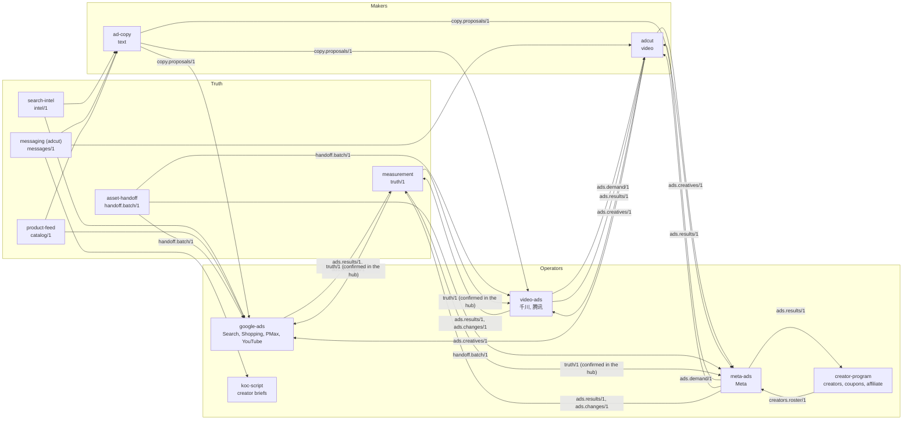

# Solutions: which skill packs serve which kind of client, and how they work together

[portfolio.md](portfolio.md) says where each pack sits and what it owns. This page puts packs together for a client. Each **solution** is the set of packs one kind of business needs, the order they start in, and the documents that carry work between them. A client gets one client hub (one facts store, one intake, one inbox, one exchange folder) and the packs of its solution, added to that hub one at a time.

Every solution runs on the same three layers:

| Layer | What it is |
| --- | --- |
| Platform | the kit; the client hub (`scaffold/new_hub.py`); `cloud-gpu` for self-hosted generation; `filmkit` to render a finished film |
| Truth | facts with one owner each: `product-feed` (catalog/1), `measurement` (truth/1), `search-intel` (intel/1), `asset-handoff` (handoff.batch/1), messaging (messages/1, from adcut for now) |
| Contracts | the twelve documents in [`contracts/`](../contracts/README.md), written once into the hub's exchange folder |

## The five solutions

| Solution | For | Operators | Truth | Makers |
| --- | --- | --- | --- | --- |
| **A. Brand, paid growth on several channels** | a direct-to-consumer brand with a site, ads on feeds and search, and creators | `meta-ads`, `video-ads` (千川, 腾讯), `google-ads`; `koc-script`, `creator-program` when creators are part of it | `product-feed`, `measurement`, `search-intel`, `asset-handoff`, messaging | `adcut`, `ad-copy`, `product-keyframe-video` |
| **B. Short-video commerce in a regulated category** | a brand selling through feed video on Chinese platforms, with claims a regulator limits (medicine, health, finance) | `video-ads` (千川, 腾讯) | `measurement`; messaging and the claims scope | `adcut` (with the kit's `compliance`), `product-keyframe-video` |
| **C. Marketplace seller** | a seller whose sales happen on Amazon | `amazon-ppc` | `search-intel`, `measurement` | `adcut` for Sponsored Brands video, when wanted |
| **D. B2B, organic and sales-led** | a manufacturer or exporter that wins buyers through search, AI answers and outreach | `ecommerce-seo`, `geo-china` (China) or a global GEO pack (not built), `outbound`, `sdr` | `search-intel`, `measurement` | `proofcut` for a manufacturer's own footage (the agent writes the copy; `seo` publishes) |
| **E. Our own acquisition** | the agency's own pipeline of clients | `seo-programmatic`, `seo-tools`, `geo-china`, `outbound`, `sdr` | `search-intel` | — |

A client may need two solutions. A brand that also sells on Amazon is A plus C, on one hub; each pack still runs only its own platform.

## How the packs of solution A work together

Solution A is the largest; the others are subsets of it.

The loop, in words:

1. **What to say.** `search-intel` says what people search for and what competitors say. Messaging (the insight matrix and the claims scope) says what the brand may say to whom. `product-feed` says what is for sale, at what price, in which promotion window.
2. **Make.** `adcut` makes video, `ad-copy` writes and checks the text for each placement, and `asset-handoff` names every creative and tags it once.
3. **Run.** `meta-ads`, `video-ads` and `google-ads` run the ads. Each proposes; a person approves every change; each writes only its own platform. Creators' work enters `meta-ads` through `creator-program`'s roster.
4. **Learn.** Operators send results and changes to `measurement`, which compares them with the company's own numbers. Its confirmed values (the coefficient, the break-even ROAS, which campaign types to trust) go into the hub's facts, and the operators read them as their targets. Results also go back to `adcut` (which creative to make more of) and to `creator-program` (what each creator and code earned).

## Starting a client

1. `scaffold/new_hub.py` makes the client's hub; the first meeting's intake goes into its `intake/`, tagged by pack (`check_intake.py --packs`).
2. Add packs in this order, each with `new_hub.py add-pack`:
   1. the operator closest to the money (the ads already running);
   2. `measurement`, so every later change has a baseline;
   3. the makers;
   4. the other truth packs as the operators ask for them.
3. One inbox serves every pack: at most 10 open asks per owner across the client.
4. A pack that needs a document no producer writes yet says so as a waiting row. It never reads another pack's database instead.

## What each solution still lacks (2026-10-23)

| Solution | Missing or not proven |
| --- | --- |
| A | `google-ads` waits for the client's access; `product-feed`, `search-intel`, `measurement`, `asset-handoff` and `ad-copy` are local only (no remote, no leak guard yet); messaging is still inside adcut |
| B | `measurement` has not met this kind of client; the kit's merged `compliance` is phase 6 of the portfolio |
| C | `amazon-ppc` is not on the kit (playbook R3), so it reads and writes contracts only at its edges once it does |
| D | no owner for global AI answers (ChatGPT, Perplexity, AI Overviews); `outbound` to `sdr` through leads/1 is in review |
| E | `seo-programmatic`'s generator still lives in its case repository |
